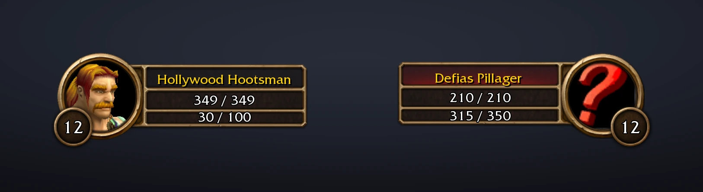
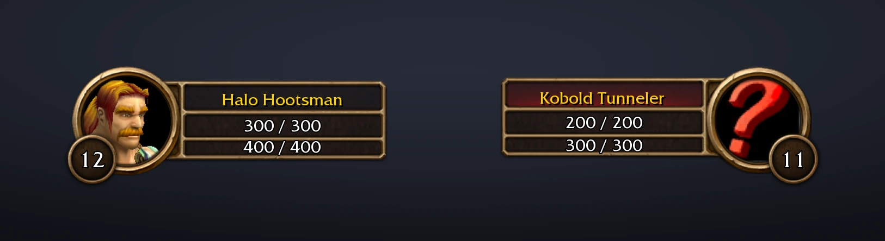
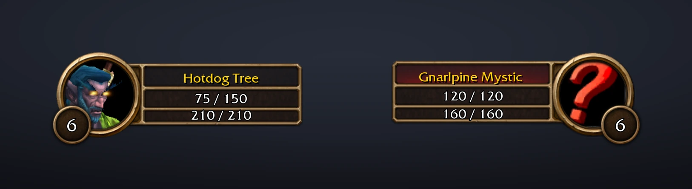
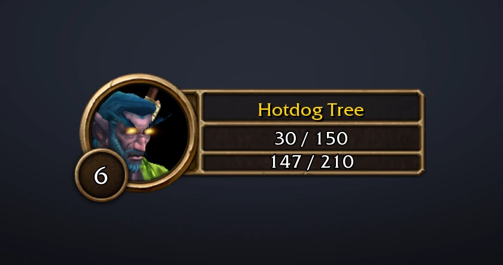

# Smooth Animated Bars

Liquid health and power bars for your player and target frames in **WoW Forever**. The liquid from
[Smooth Experience Bar](https://www.curseforge.com/wow/addons/smooth-experience-bar) — waves, a swirl of magic,
bubbles, sparkles and lightning — now fills the bars you watch all fight long.

Your frames stay the game's own. Only the fill changes, so nothing moves: log in and your bars are liquid. A
short setup on the first login lets you choose the look, or skip it.

## What you get

- **Liquid in all four bars:** your health and power, and your target's.
- **Every power type:** mana, rage, energy and focus, each in its own colour, as the game shows it.
- **Moves with the fight:** the liquid eases to wherever the game's bar is, and stirs with every hit, heal,
  cast and tick.
- **25 themes:** keep the game's colours, or pick Class Color, Fire, Frost, Arcane, Shadow, Void and more, many with
  particles of their own. Health and power each get their own choice.
- **Your call on every effect:** waves, swirl, bubbles, sparkles, theme particles and lightning can each be
  switched off, and so can each bar.
- **Your DoTs on the target (optional):** liquid in your DoTs' own colours eats into your target's health as
  far as they will still burn it, and the game's skull shows on its portrait when they will finish it.
- **Your heals on the way:** your own heals over time, bandages and the heal you are casting on yourself show
  ahead of your health as far as they will still bring it, and pour into it.
- **Food and drink:** what you are eating and drinking shows ahead of your health and mana, and food with a buff
  builds up to a burst of stars when you become well fed.
- **A quick setup** the first time you log in, with preview frames that show each choice as you pick it.

<em>Mage: every Fireball takes a bite out of your mana, and out of the kobold.</em>

<em>Rogue: energy flows back smoothly and pours out again on every strike.</em>

## Your DoTs on the target

<em>Warlock: Corruption eats in as Shadow, then Immolate joins behind it as Fire. When no green is left, they will finish it.</em>

<em>Warrior: Rend bleeds as Blood. When no green is left, it will finish the pillager.</em>

Turn it on in the setup or under Damage Over Time in the settings. The health your damage-over-time spells
will still burn away turns into liquid, eating into your target's health liquid:

- **Each school is a liquid of its own:** Shadow, Fire, Frost, Arcane, Holy, Plague for Nature and
  Blood for bleeds. The school you put up first sits at the front of the health, the next behind it. Two
  schools show at once; a third joins the second. Each ripples with every tick and splashes when a DoT
  lands.
- **The health liquid's front** sits where the target's health will end once your DoTs are done.
- **If no health liquid is left**, your DoTs will kill it, and the game's own skull (the one it shows for a
  target far above your level) comes up on its portrait.
- **It goes by your spells' tooltips.** WoW Forever keeps the damage of each hit hidden from addons, so the
  amounts come from what each spell's tooltip says it deals, and a DoT runs down tick by tick for its whole
  duration. A DoT that is dodged, parried, missed or resisted as you cast it is left out.
- **Your own DoTs only**, on your current target. Spells that do damage over time on the ground (Rain of Fire,
  Consecration) and channels (Drain Life, Mind Flay) are left out.

It reads English spell text, so on other client languages it may not pick up your DoTs. If you use DoesItDie,
which draws its own marker, this one stays off while DoesItDie is loaded.

## Your heals on the way

<em>Priest: Renew and Flash Heal glow Holy ahead of the health, and a bandage goes up past them, throwing up green pluses.</em>

<em>Druid: Moonfire stays up on the mystic while Rejuvenation ticks and Healing Touch bursts in.</em>

On by default, under Healing in the settings. The health your own heals will still bring back shows ahead of
your health as a liquid of its own:

- **Holy gold** for priest and paladin heals, **spring green** for druid and shaman heals and for bandages,
  paler than the health so it stands out. Both at once show side by side, the one you started first next to
  the health.
- **It pours in:** its particles drift back into your health liquid, whose front ripples and takes on some of
  the incoming colour.
- **A heal you cast bursts into your health as it lands:** leaves for Nature, holy sparks for Holy. While you
  cast it, it shows at its lowest roll.
- **Heals over time** (Renew, Rejuvenation, Regrowth) run down tick by tick for their duration.
- **Bandages** tick every second, throwing up green pluses as the game does over a healed character, and if
  damage breaks one, what it had left drops out at once.
- **It goes by your spells' tooltips**, as the DoT marker does: WoW Forever keeps your health and each heal's
  size hidden from addons. Healing past full health is cut off at the bar's end.
- **Your own heals on yourself only.** Heals from others depend on their gear, which no tooltip tells, so they
  keep the game's own bar. Your own heals take the place of the game's flat teal bar while they show.

It reads English spell text, so on other client languages it may not pick up your heals, food or drink.

## Food and drink

<em>Eating: the honey pours in, the bar builds up, and a burst of stars says you are well fed.</em>

- **Food** is a Honey liquid ahead of your health, and **drink** a Nagrand liquid ahead of your mana, each
  pouring into its bar.
- **Food with a buff builds up while you eat,** even at full health, then lets go in a burst of stars once you
  have eaten long enough to become well fed. Slow stars keep rising after that, so you know you can get up.
- **Moving or casting anything else** stands you up and ends them.

## Make it yours

Open the settings with `/sab`, or from Options > AddOns > Smooth Animated Bars:

- **Bars:** Player Health, Player Power, Target Health and Target Power, each on or off.
- **Colours:** Health Colour and Power Colour. Game Colour keeps green health and the game's power colours
  (blue mana, red rage, yellow energy); any theme brings its own colours and particles.
- **Effects:** Liquid Waves, Magic Swirl, Bubbles, Sparkles, Theme Particles and Lightning.
- **Damage Over Time:** DoT Marker and Kill Icon.
- **Healing:** Heal Marker, for your heals, bandages, food and drink.
- **Setup Wizard:** run the four-step setup again.

The setup asks which bars you want (player and target, just yours, or just health), picks the colours from a
few favourites, how lively the liquid should be (everything, gentle, or still), and whether to mark your DoTs
(marker and skull, just the marker, or off). Skip puts everything back as it was.

## Commands

| Command | |
|---|---|
| `/sab` | Open the settings |
| `/sab on` / `/sab off` | Liquid in all four bars, or back to the game's own bars |
| `/sab setup` | Open the setup again |
| `/sab debug` | What each bar is doing, if something looks wrong |
| `/sab dots` | Your DoTs on the target, and what the DoT tracking saw lately |
| `/sab heals` | Your heals, food and drink on the way to you, and what the tracking saw lately |

## Good to know

- **WoW Forever only.** It draws on Forever's own player and target frames.
- **Player and target frames.** Party, focus and target-of-target frames keep the game's bars.
- **Always matches the game.** WoW Forever keeps health and power hidden from addons, so the addon never knows
  how full a bar is: the game itself places the liquid on its own bar. That is why it always matches the game
  exactly, and also why a hit and someone else's heal both just stir the liquid rather than each getting an
  effect of its own.
- **Light on your game.** Once the bars settle, the liquid drops to a low update rate.

## Install

Install it from CurseForge, or download the zip from the
[releases page](https://github.com/Jordanburch101/smooth-animated-bars/releases/latest), copy the
`SmoothAnimatedBars` folder inside it into `World of Warcraft/_forever_/Interface/AddOns/`, then restart the game.

## Credits

- **The liquid** comes from [Smooth Experience Bar](https://www.curseforge.com/wow/addons/smooth-experience-bar),
  whose look is based on the [Luxthos Experience Bar](https://wago.io/LuxthosExperienceBar) WeakAura by
  Luxthos & Daemoos.
- **The DoT tracking** is ported from DoesItDie by Joe Greive (MIT licence), which worked out how to follow
  your DoTs on WoW Forever, where the combat log is closed to addons. The idea of marking them on the
  target's health bar is its too.
- **The art** is the game's own: the addon's icon (Greater Nether Essence), the kill icon's skull, and the
  unit frames in the images above, captured in game.

Smooth Animated Bars is not affiliated with or endorsed by Blizzard Entertainment. World of Warcraft and its
art belong to Blizzard Entertainment.

## License

[MIT](LICENSE). `SmoothAnimatedBars/Dots.lua` contains code from DoesItDie, also under the MIT licence; its
notice is kept in that file and listed in [LICENSE](LICENSE). The game's art is not covered by the licence.

Building, testing or adding a theme: see [docs/DEVELOPMENT.md](docs/DEVELOPMENT.md).
