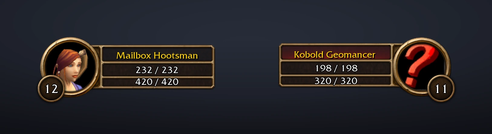
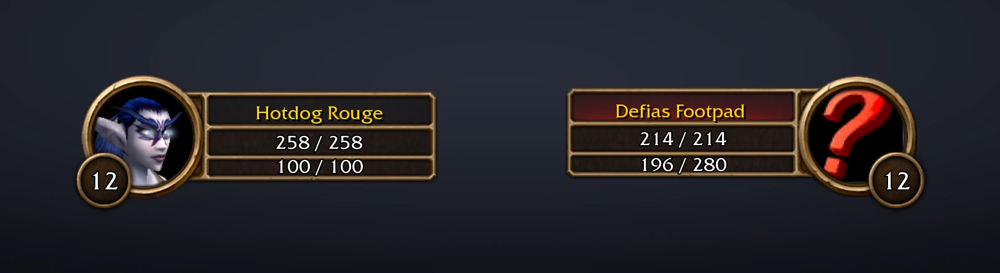
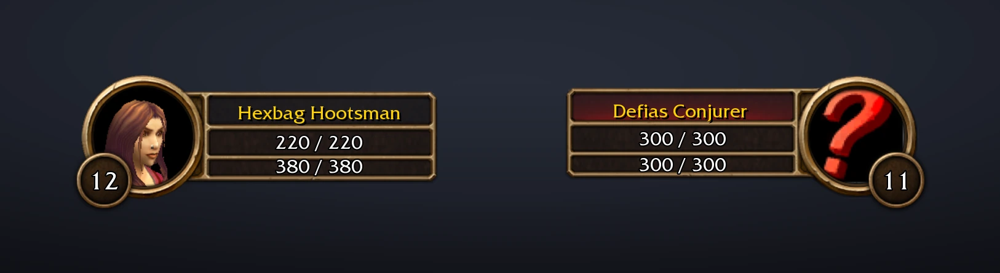
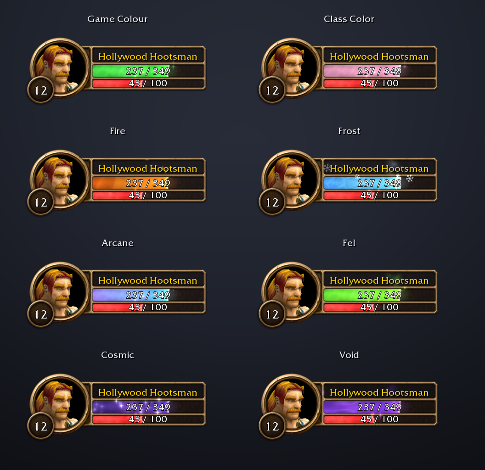

# Smooth Animated Bars

Liquid health and power bars for your player and target frames in **WoW Forever**. The liquid from
[Smooth Experience Bar](https://www.curseforge.com/wow/addons/smooth-experience-bar) — waves, a swirl of magic,
bubbles, sparkles and lightning — now fills the bars you watch all fight long.

Your frames stay the game's own. Only the fill changes, so nothing moves: log in and your bars are liquid. A
short setup on the first login lets you choose the look, or skip it.

## What you get

- **Liquid in all four bars:** your health and power, and your target's.
- **Every power type:** mana, rage, energy and focus, each in its own colour, as the game shows it.
- **Moves with the fight:** the liquid eases to wherever the game's bar is, and stirs with every hit, heal,
  cast and tick.
- **24 themes:** keep the game's colours, or pick Class Color, Fire, Frost, Arcane, Void and more, many with
  particles of their own. Health and power each get their own choice.
- **Your call on every effect:** waves, swirl, bubbles, sparkles, theme particles and lightning can each be
  switched off, and so can each bar.
- **Your DoTs on the target (optional):** a second liquid, in your DoTs' own colour, eats into your target's
  health as far as they will still burn it, and the game's skull shows on its portrait when they will finish it.
- **A quick setup** the first time you log in, with preview frames that show each choice as you pick it.

<em>Mage: every Fireball takes a bite out of your mana, and out of the kobold.</em>

<em>Rogue: energy ticks back and pours out again on every strike.</em>

<em>Warlock: Corruption and Immolate eat into the target's health. When no green is left, they will finish it.</em>

## Your DoTs on the target

Turn it on in the setup or under Damage Over Time in the settings. The health your damage-over-time spells
will still burn away turns into a second liquid, eating into your target's health liquid:

- **Its colour is your DoTs' school:** Void for Shadow, Fire, Frost, Arcane, Holy, Plague for Nature and Blood
  for bleeds, after whichever DoT has the most left to deal. It ripples with every tick and splashes when a
  DoT lands.
- **The health liquid's front** sits where the target's health will end once your DoTs are done.
- **If no health liquid is left**, your DoTs will kill it, and the game's own skull (the one it shows for a
  target far above your level) comes up on its portrait.
- **It goes by your spells' tooltips.** WoW Forever keeps the damage of each hit hidden from addons, so the
  amounts come from what each spell's tooltip says it deals, and a DoT runs down tick by tick for its whole
  duration. A DoT that is dodged, parried, missed or resisted as you cast it is left out.
- **Your own DoTs only**, on your current target. Spells that do damage over time on the ground (Rain of Fire,
  Consecration) and channels (Drain Life, Mind Flay) are left out.

It reads English spell text, so on other client languages it may not pick up your DoTs. If you use DoesItDie,
which draws its own marker, this one stays off while DoesItDie is loaded.

## Make it yours

Open the settings with `/sab`, or from Options > AddOns > Smooth Animated Bars:

- **Bars:** Player Health, Player Power, Target Health and Target Power, each on or off.
- **Colours:** Health Colour and Power Colour. Game Colour keeps green health and the game's power colours
  (blue mana, red rage, yellow energy); any theme brings its own colours and particles.
- **Effects:** Liquid Waves, Magic Swirl, Bubbles, Sparkles, Theme Particles and Lightning.
- **Damage Over Time:** DoT Marker and Kill Icon.
- **Setup Wizard:** run the four-step setup again.

The setup asks which bars you want (player and target, just yours, or just health), picks the colours from a
few favourites, how lively the liquid should be (everything, gentle, or still), and whether to mark your DoTs
(marker and skull, just the marker, or off). Skip puts everything back as it was.

## Commands

| Command | |
|---|---|
| `/sab` | Open the settings |
| `/sab on` / `/sab off` | Liquid in all four bars, or back to the game's own bars |
| `/sab setup` | Open the setup again |
| `/sab debug` | What each bar is doing, if something looks wrong |
| `/sab dots` | Your DoTs on the target, and what the DoT tracking saw lately |

## Good to know

- **WoW Forever only.** It draws on Forever's own player and target frames.
- **Player and target frames.** Party, focus and target-of-target frames keep the game's bars.
- **A hit or a heal look alike.** WoW Forever keeps health and power hidden from addons, so the addon never
  knows how full a bar is: the game itself places the liquid on its own bar. That is why it always matches the
  game exactly, and also why a heal and a hit both just stir the liquid rather than each getting an effect of
  its own.
- **Light on your game.** Once the bars settle, the liquid drops to a low update rate.

## Install

Download the latest version from the [tags page](https://github.com/Jordanburch101/smooth-animated-bars/tags)
(the zip of its source), copy the `SmoothAnimatedBars` folder inside it into
`World of Warcraft/_forever_/Interface/AddOns/`, then restart the game.

## Credits

The liquid comes from [Smooth Experience Bar](https://www.curseforge.com/wow/addons/smooth-experience-bar),
whose look is based on the [Luxthos Experience Bar](https://wago.io/LuxthosExperienceBar) WeakAura by
Luxthos & Daemoos. The DoT marker's tracking is ported from DoesItDie by Joe Greive (MIT licence), which
worked out how to follow DoTs on WoW Forever. Smooth Animated Bars is not affiliated with or endorsed by
Blizzard Entertainment.

Building, testing or adding a theme: see [docs/DEVELOPMENT.md](docs/DEVELOPMENT.md).
