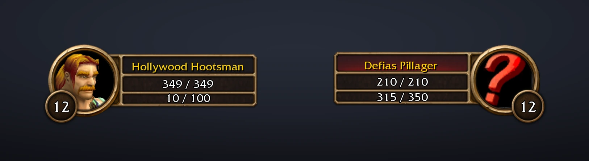

# Smooth Animated Bars

**Liquid health and power bars for WoW Forever: your unit frame, your target's, pet's, focus's and target of target's, your party and raid, the Personal Resource Display and nameplates.** Waves, swirls, bubbles, sparkles and lightning fill the bars you watch all fight, and they show what's coming: your heals, bandages, food and drink pour into your bars, and your DoTs eat into your target's.

Your frames stay the game's own; only the fill changes, unless you make their bars taller. A short setup on your first login lets you pick a look, or skip it.

## Features

*   **Liquid in every bar** of your frame, your target's, pet's, focus's and target of target's, and your party's.
*   **Raid frames (optional):** health and power for every raid member, and for your party in raid-style frames.
*   **Nameplates (optional):** enemy and friendly nameplates, with your DoTs on every mob that has them.
*   **The Personal Resource Display:** the game's extra health and power bars, with everything your own frame gets.
*   **Bar Height (optional):** make any frame's health and power bars taller, the frame drawn from the game's own art.
*   **Every power type:** mana, rage, energy and focus, in the game's colours.
*   **Follows the fight:** the liquid moves to wherever the game's bar is, and stirs with every hit, heal and tick.
*   **25 themes:** the game's colours, Class Color, Fire, Frost, Arcane, Shadow, Void and more. Each frame's health and power can have its own.
*   **Effects you control:** waves, swirl, bubbles, sparkles, theme particles and lightning can each be turned off, for every bar or just one.
*   **Your DoTs on the target (optional):** your damage over time eats into your target's health as liquid, and a skull shows when it will kill the target.
*   **Your heals, food and drink:** what is still to come shows ahead of your health and mana.
*   **Shields and Weakened Soul:** a shield on you turns the end of your health into golden glass, and Weakened Soul shows as ash on your health's edge until you can be shielded again.
*   **Mana regen build-up:** your mana bar shows the five-second wait after a spell.
*   **Rage Fury:** your rage bar heats up as it fills, and bursts when you spend it.
*   **An editor** with every setting beside live examples of your frames: type `/sab`, or right-click your frame.

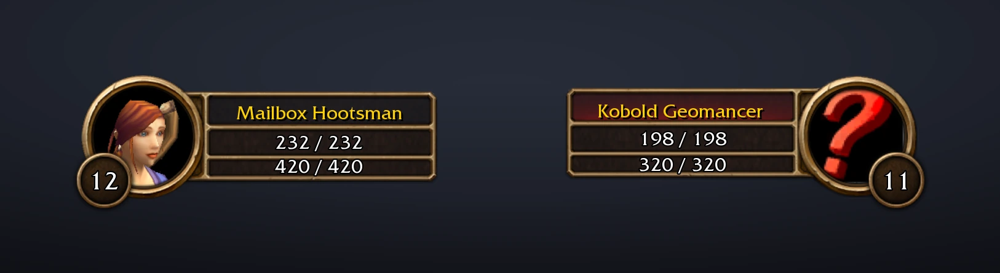

_Mage: each Fireball takes a chunk of your mana, and of the kobold's health._

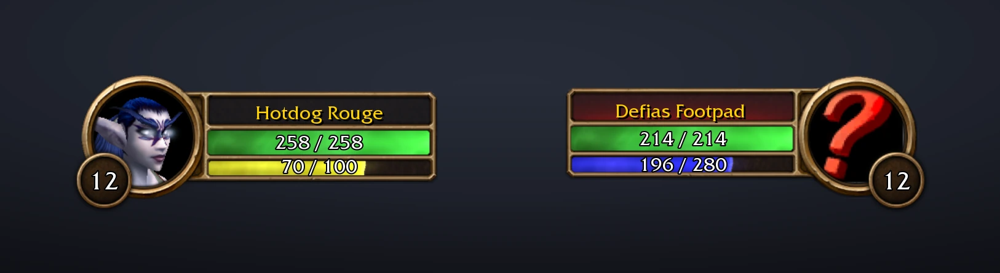

_Rogue: energy refills smoothly and drains with every strike._

## Party frames

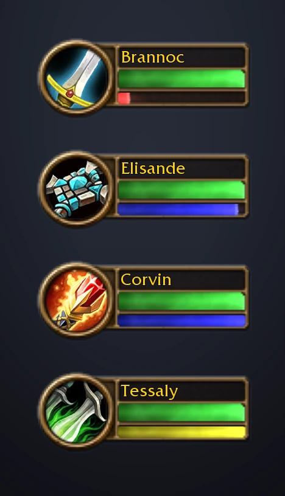

_Party: each member's health and power in their own colours._

On by default, under Party in the editor, or right-click a party member's frame and choose Open Editor.

*   **Each bar follows its member,** wherever the game puts them.
*   **Colours:** Same as Yours, Class Color, or Game Colour (each member's power colour).
*   **Offline members** get the game's grey bar back until they return.
*   **The game's incoming heals and shields** still show.
*   **Raid-style party frames** go by the Raid settings below.

## Raid frames

_Raid: the tanks build rage, the whole raid takes a hit and is healed back, and the casters' mana drains._

Turn on Health and Power under Raid in the editor.

*   **The game's raid frames,** and your party's in raid-style frames.
*   **The game's names, icons, health text, heals, shields and target highlight** stay on top of the liquid.
*   **Colours:** health takes the raid frames' own colours (class colours, or the colour set in the game's Raid Frames options), and power its power type's colour. Or pick any theme.
*   **Offline members** get the game's grey bar back.
*   **Big raids** update less often, to stay light.

## Personal Resource Display

_Personal Resource Display: the rage heats up and bursts with each spend, then a bandage fills the health._

The game's extra health and power bars, shown with its Personal Resource Display option on. On by default, under Personal Resource in the editor.

*   **Fits the game's bronze bars,** with the bar text on top.
*   **Everything your own frame gets:** heals, bandages, food, drink, the mana build-up and Rage Fury.
*   **Colours:** Same as Yours, or Game Colour (the display's own, including its class colour setting in Edit Mode).
*   **Druids in Cat or Bear Form** get the liquid in the mana bar underneath too.
*   **Shown only in combat** (an Edit Mode setting)? The liquid picks up where the bar is each time it appears.

## Your heals on the way

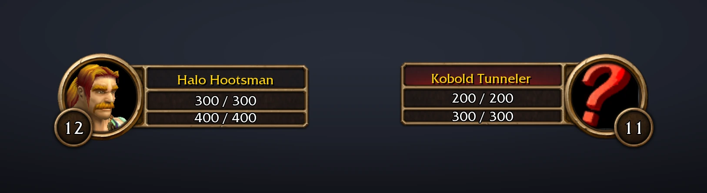

_Priest: Renew and Flash Heal show in gold ahead of the health, then a bandage in green._

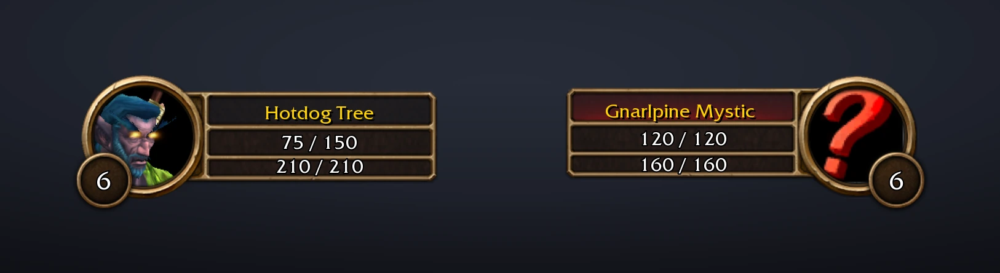

_Druid: Moonfire on the target, Rejuvenation ticking, and Healing Touch landing._

On by default, under Heal Marker in the editor. The health your own heals will still restore shows ahead of your health, and ahead of your party and raid members' health on the party and raid-style frames:

*   **Colours:** gold for priest and paladin heals, green for druid and shaman heals and bandages. Two at once show side by side.
*   **Cast heals** show at their lowest roll while you cast, and burst in as they land.
*   **Heals over time** (Renew, Rejuvenation, Regrowth) count down tick by tick.
*   **Bandages** tick every second. If damage interrupts one, the rest drops away.
*   **It uses your spells' tooltips,** as WoW Forever hides your health and each heal's size from addons. Healing past full is cut off at the end of the bar.
*   **On yourself, your party and your raid.** On party and raid members it shows while their health has the liquid. Raid-style frames show all your heals on someone in one colour, the first heal's.
*   **Other players' heals** show too, as a silvery teal liquid after yours, while another player is casting a heal on someone. The size is the game's own prediction, the same one its flat bar shows.
*   **It takes over the game's bars:** the game's flat prediction bars for your heals and others' stay hidden while the marker shows.

It reads spell text in English, French, German, Spanish, Portuguese, Russian, Korean and Chinese. Tranquility and food that restores a share of your health each second don't show.

## Food and drink

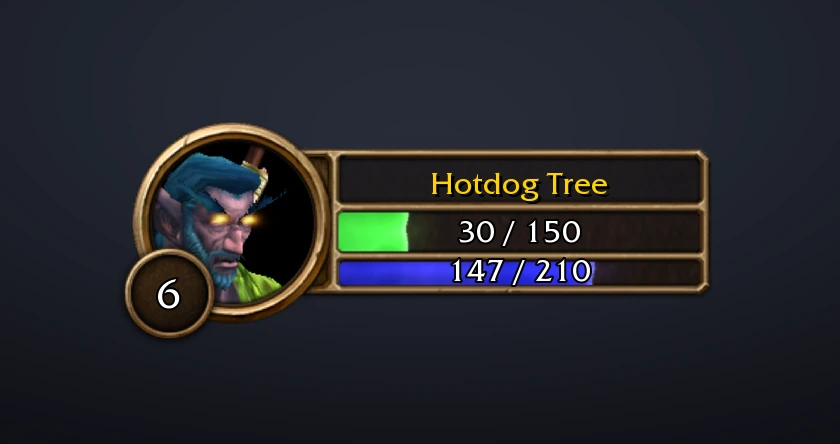

_Eating: the food fills in, and a burst of stars shows when you are well fed._

*   **Food** shows as a honey liquid ahead of your health, and **drink** as a liquid ahead of your mana.
*   **Food with a buff** builds up while you eat, even at full health, and bursts into stars once you are well fed. Slow stars keep rising after that, so you know you can get up.
*   **Moving or casting** stands you up and ends it.

## Shields and Weakened Soul

_Priest: Power Word: Shield soaks five hits, wearing down, and shatters._

On by default, under Shield and Weakened Soul in the editor.

*   **Shields:** while Power Word: Shield or any other shield is on you, the end of your health turns into golden glass, as much as the shield will soak. It flares when it soaks a hit and shatters when it ends.
*   **Weakened Soul:** after a Power Word: Shield lands on you, your health's edge turns to ash and warms back to gold over its 15 seconds, then flashes when you can be shielded again. While the shield still holds, its rim shows the same.
*   **It's timed from the shield going up,** as WoW Forever hides your debuffs from addons in combat. Out of combat it reads Weakened Soul itself. In combat a shield you didn't cast yourself, such as a Voidwalker's Sacrifice, can start it too.

## Your DoTs on the target

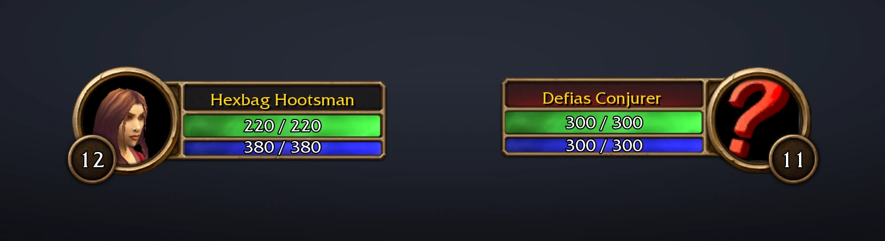

_Warlock: Corruption (Shadow) and Immolate (Fire) eat into the health. When no green is left, they will kill it._

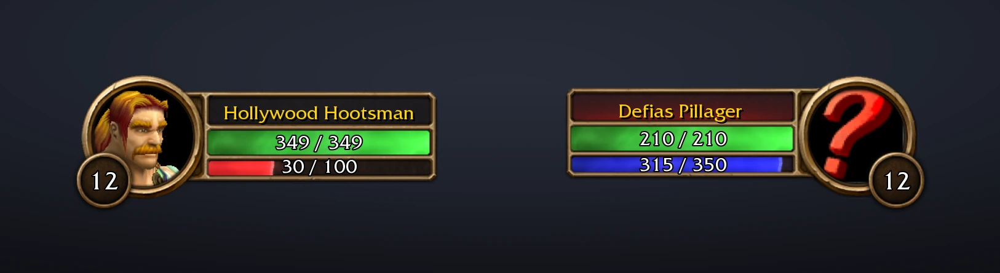

_Warrior: Rend shows as Blood. When no green is left, it will kill the pillager._

Turn it on in the setup or under DoT Marker in the editor. The health your DoTs will still take shows as liquid, eating into your target's health:

*   **Each school has its own colour:** Shadow, Fire, Frost, Arcane, Holy, Plague for Nature, and Blood for bleeds. Two schools show at once; a third joins the second.
*   **The health's front** shows where the target's health will be once your DoTs are done.
*   **A skull** shows on the target's portrait when your DoTs will kill it.
*   **It uses your spells' tooltips.** WoW Forever hides each hit's damage from addons, so each DoT counts down by its tooltip. A DoT that misses or is resisted is left out.
*   **Nature DoTs** give off the game's poison skulls.
*   **Rogue poisons** with damage over time, like Deadly Poison, show too. Only one stack is counted.
*   **Your own DoTs on your current target only.** Ground effects (Rain of Fire, Consecration) and channels (Drain Life, Mind Flay) are left out.

It reads spell text in English, French, German, Spanish, Portuguese, Russian, Korean and Chinese; rogue poisons and Immolation Trap in English only. While DoesItDie is loaded, this marker stays off so you don't get two.

## Nameplates

_Nameplates: Rend on the pillager until the skull shows, Corruption and Immolate on the geomancer, and the boar and guard in their own colours._

Turn them on in the setup or under Nameplates in the editor. Enemy and friendly nameplates are separate settings.

*   **Enemy nameplates** take the nameplate's colour (red, or yellow for neutral) or your target's. Up to 15 at once.
*   **Friendly nameplates** have their own colour: the nameplate's, any theme, or Class Color for players. Up to 10 at once, counted apart from enemies. In dungeons they keep the game's bar, as the game hides them from addons.
*   **Your DoTs on nameplates:** every mob with your DoTs shows them, even after you change target, with a skull beside its plate when they will kill it (Kill Icon on Nameplates).
*   **Health numbers** turned on in the game's nameplate settings show over the liquid.

## Mana regen build-up

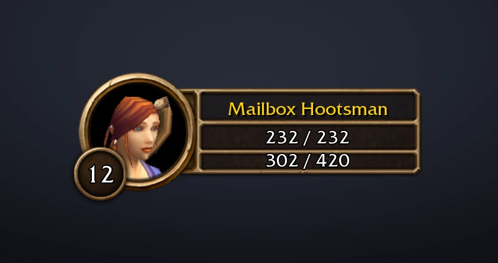

_Mana: the bar builds up through the five seconds after a spell, then lets go as mana starts coming back._

On by default, under Mana Build-Up in the editor. After a spell that costs mana, your mana stops regenerating from Spirit for five seconds. Your mana bar shows that wait:

*   **It builds up:** sparks gather at the front, which turns pale, and lightning starts. The front stays put, so you can still read your mana.
*   **It lets go** in a burst of stars when regeneration returns.
*   **Any spell that costs mana restarts the wait.** Free spells like Shoot don't.
*   **It's timed from your casts,** as WoW Forever hides your mana from addons. The burst still plays at full mana, and Meditation and mp5 gear still bring some mana back during the wait.
*   **While you drink,** the drink shows instead. In a druid's Bear or Cat Form, it waits for the mana bar to come back.

## Rage Fury

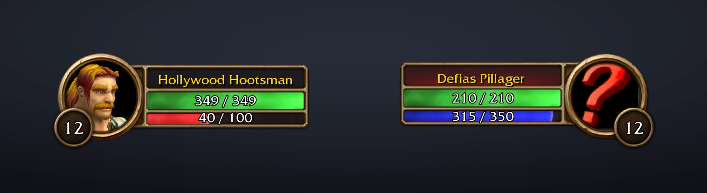

_Rage: the bar heats up as it fills, and bursts when you spend it._

On by default, under Rage Fury in the editor.

*   **It heats up** from about half rage: the red turns orange, with flames, lightning and sparks.
*   **At full rage** it pulses and throws off sparks.
*   **Spending rage** throws off sparks, and the bar drops back to red.
*   **It shows exactly as far as your rage goes,** as the game itself fades it in. It works on any rage bar: yours, a druid's in Bear Form, your target's.

## Bar Height

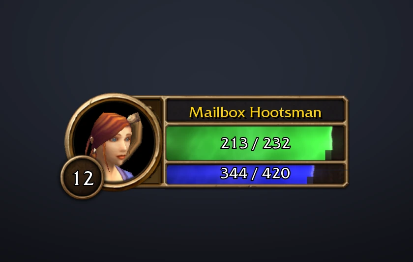

_Mage: the health and mana bars from the game's height up to twice it, settling in between._

Off to start with: each frame keeps the game's heights until you change them, with Health Bar Height and Power Bar Height on its page in the editor. It works on your player, target, focus, pet, target of target and party frames.

*   **Drawn from the game's own art,** cut and stretched to fit. The portrait's ring grows once the bars would reach past it.
*   **Your player, target and focus frames grow upward,** so your target's debuffs and cast bar below stay clear. With Buffs on Top, the target and focus grow downward instead. The pet, target of target and party frames grow downward, party members only as far as the gap between them.
*   **Everything the game shows stays:** name, level, portrait, icons, the combat glow, incoming heals, shields, the mana a spell will cost, and the heal marker, Shield and Weakened Soul.
*   **Back at the game's heights,** the game's own frame shows again.

## Proven compatibility

Unit frame addons that replace the game's frames, tested in game. Use one at a time.

*   **[FlareUI](https://www.curseforge.com/wow/addons/flareui)** by Malkkav and the FlareUI team, built in since FlareUI 6.10: its player, target, focus, pet and target of target frames, its party's health and its Resource Bars. Its heals and shields stay on top, and its round portrait style shapes the liquid.
*   **[Frames Forever](https://www.curseforge.com/wow/addons/frames-forever)** by Halfdays, built in since Frames Forever 1.4.3: its health and power bars, flowing the other way on bars that show health lost, with your DoTs on its target.
*   **[ClassicUI Forever](https://www.curseforge.com/wow/addons/classicui-forever)** by justawower, from Smooth Animated Bars 1.11.0: Smooth Animated Bars finds its player, target, focus, target of target and party bars itself, under its frame art, and fits your pet's bars to its smaller frame. Its standalone Unit Frames piece works too.

FlareUI's and Frames Forever's bars are on by default under Other Addons' Bars, and keep their own colours unless you tick Your Colours on Their Bars. ClassicUI Forever's follow each frame's own settings, as the game's frames do. Your heals, food, drink and mana build-up show on all of them, and your DoTs on their target with the DoT Marker on. `/sab off` turns every bar back to the game's.

**Using another unit frame addon?** If it replaces the game's frames, the liquid has nowhere to show until it hands its bars over. Point its author to the [For addon authors](https://github.com/Jordanburch101/smooth-animated-bars#for-addon-authors) section of the README: it takes a few lines.

## Make it yours

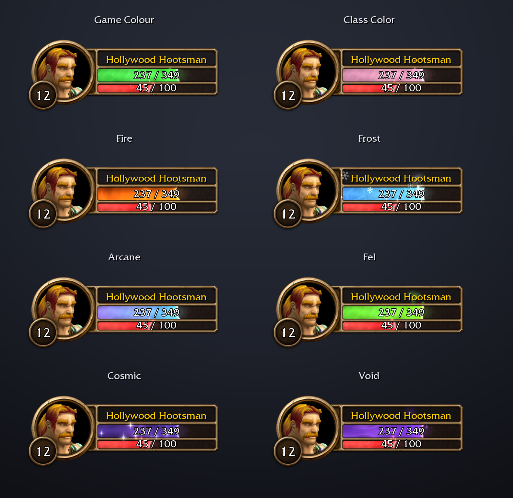

Open the editor with `/sab`, with **Open Editor** in the menu when you right-click a frame (it opens at that frame), or from **Options > AddOns > Smooth Animated Bars**.

It shows live examples of all your frames, laid out as on your screen. Play a fight, damage, healing or power on all of them at once. Click a frame to change it; frames with the liquid off are dimmed. Each bar has two tabs: **Colour**, with a tile for every theme (hover over one to try it on your bars), and **Effects**, the global ones or just that bar's.

_The editor: every frame on one screen. Click one to change it._

*   **Player, Target, Focus, Pet and Target of Target:** Health and Power on or off, and a colour for each. Game Colour keeps the game's colours. Your target and pet start out following your colours; your focus and target of target follow your target's.
*   **Party, Raid and Personal Resource:** the same. Party and the Personal Resource Display start as Same as Yours; raid frames start with their own colours.
*   **Class Color** shows each unit's class. On a mob, Class Color on Mobs picks what shows instead: Reaction (red, yellow or green), Game Colour, Mob's Class or Your Class.
*   **Nameplates:** enemy and friendly nameplates, each with its own colour, and Your DoTs on Nameplates with their Kill Icon.
*   **Effects tab:** Liquid Waves, Magic Swirl, Bubbles, Sparkles, Theme Particles and Lightning, for every bar. A bar can have its own on its Effects tab.
*   **Combat tab:** DoT Marker and its Kill Icon, Heal Marker (play Healing to see it), Mana Regen Build-Up and Rage Fury.
*   **Other Addons tab:** Other Addons' Bars (on to start with), and Your Colours on Their Bars (off to start with), which puts your colours on their bars instead of theirs, Game Colour meaning the game's own.
*   **Defaults** resets what's shown. **Run Setup** runs the setup again, and **What's New** shows recent changes.

## Commands

| Command | |
| --- | --- |
| `/sab` | Open the editor |
| `/sab off` / `/sab on` | The game's own bars everywhere, or the liquid back in your frames (raid frames and nameplates stay as they are) |
| `/sab setup` | Run the setup again |
| `/sab changes` | What changed in recent versions |
| `/sab debug` | What each bar is doing, if something looks wrong |
| `/sab dots` | Your DoTs on the target, and what the DoT tracking saw lately |
| `/sab heals` | Your heals, food and drink on the way, and what the tracking saw lately |
| `/sab mana` | The wait before your mana regenerates, and what it saw lately |
| `/sab shield` | What the game says about shields on you, and what the shield is doing |
| `/sab soul` / `/sab soul test` | What Weakened Soul saw and is doing, or 15 seconds of it on your health bar to see it |
| `/sab perf` | What the liquid costs each frame, and the costliest bars. Add a note (`/sab perf 12 mobs`) to label it |

## Good to know

*   **WoW Forever only.** It draws on Forever's own unit frames.
*   **Always in step with the game.** WoW Forever hides health and power from addons, so the game itself places the liquid on its bar. That's why it always matches exactly, and why a hit and someone else's heal both just stir it.
*   **Target of target:** its liquid follows the bar but doesn't stir, as the game sends no updates for it.
*   **Light on your game.** Settled bars update slowly, and small bars update less often even in a fight.

## Credits

*   The liquid comes from [Smooth Experience Bar](https://www.curseforge.com/wow/addons/smooth-experience-bar), whose look is based on the [Luxthos Experience Bar](https://wago.io/LuxthosExperienceBar) WeakAura by Luxthos & Daemoos.
*   The DoT tracking is ported from DoesItDie by JoeGG (MIT licence), which worked out how to follow your DoTs on WoW Forever.
*   The art is the game's own, the poison skulls too.
*   Thanks to Malkkav and the FlareUI team for building Smooth Animated Bars into FlareUI, with care for its heals, shields and portrait styles, and to Halfdays, whose Frames Forever asked for a way in and was the first to use it. ClassicUI Forever's classic frames are justawower's work.

Open source under the MIT licence: [source, issues and licence on GitHub](https://github.com/Jordanburch101/smooth-animated-bars).

_Smooth Animated Bars is not affiliated with or endorsed by Blizzard Entertainment._
